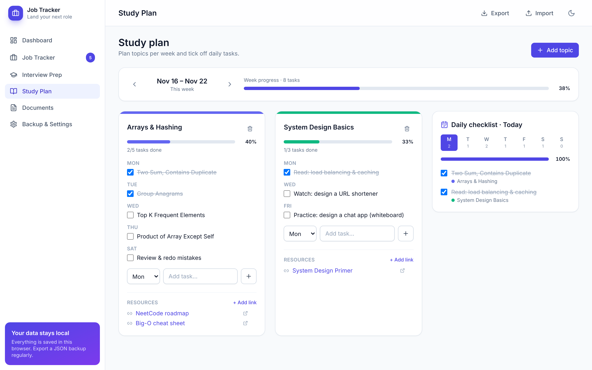
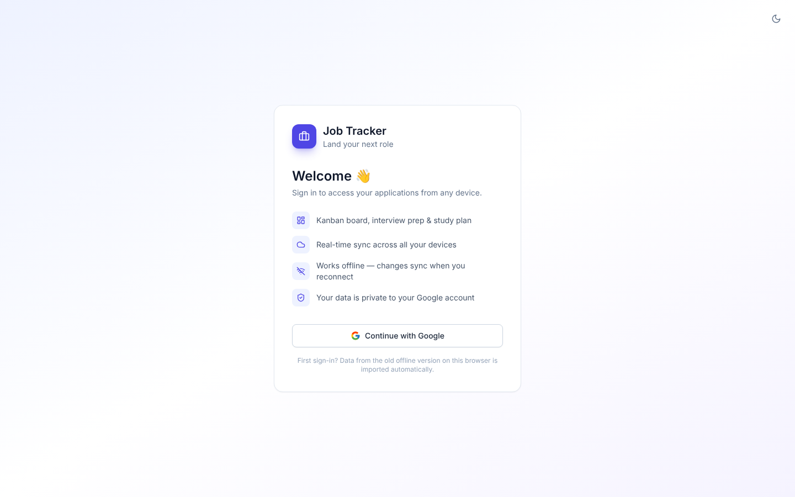
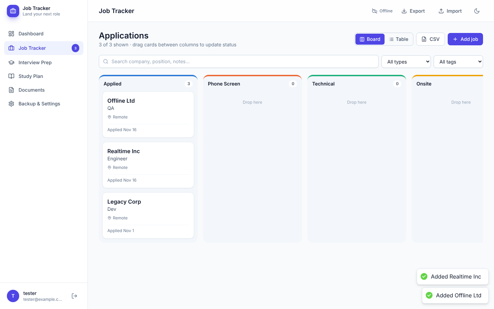
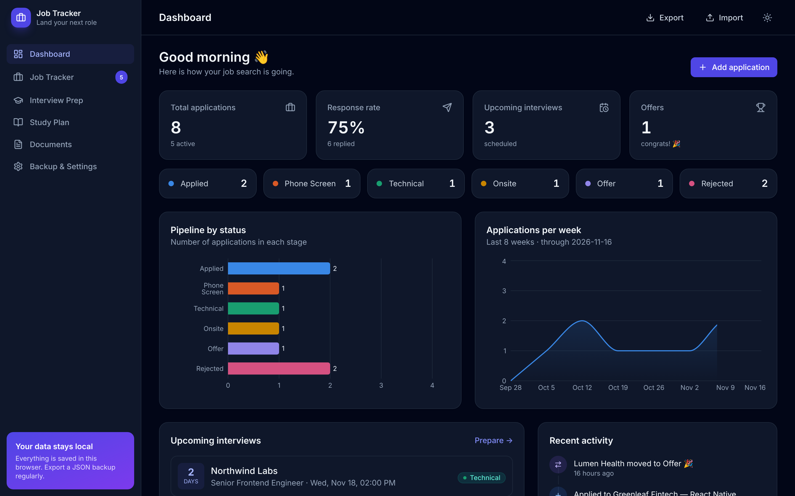
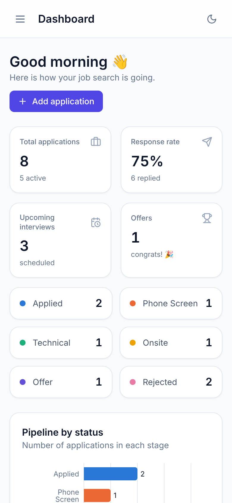

# 💼 Job Application Tracker

A complete, offline-first web app to manage your job search: track applications on a Kanban board, prepare for interviews with flashcards, plan your study week and keep every resume / cover-letter version in one place.

**Sign in with Google and your data follows you.** Everything is stored in **Firebase Firestore**, syncs in real time between your laptop, phone and tablet, and keeps working offline. JSON backup & restore is still one click away.

> 🔗 **Live demo:** `https://<your-username>.github.io/job-tracker/` (after enabling GitHub Pages, see [Deploy](#-deploy-to-github-pages))


---

## ✨ Features

### 📊 Dashboard
- KPI tiles: total applications, response rate, upcoming interviews, offers
- Count of jobs per status (Wishlist → Applied → Phone Screen → Technical → Onsite → Offer → Rejected)
- Charts (Recharts): pipeline by status and applications per week (last 8 weeks)
- Upcoming interviews (with countdown) and deadlines in the next 2 weeks
- Planned applications: your wishlist sorted by planned date and priority
- Recent activity timeline (every create / update / status change is logged)

### 🗂️ Job Tracker
- **Wishlist (planned applications)**: save jobs you intend to apply for with a planned apply date and priority (High / Medium / Low). They have their own Kanban column, show up on the dashboard under *Planned applications* (overdue plans highlighted), aren't counted in application stats, and one click on *Mark as applied* (or dragging to *Applied*) moves them on and stamps today's date
- Add / edit / delete applications: company, position, work type (Remote / Onsite / Hybrid), city, job URL, salary range, status, date applied, deadline, next interview, notes, tags, recruiter name & email
- **Kanban board**: drag & drop cards between status columns (order is persisted)
- **Table view**: sortable columns, inline status change
- Search + filters (status, work type, tag)
- **Export to CSV** (Excel-friendly UTF-8)

### 🎯 Interview Prep
- Flashcards by category: **Behavioral (STAR template)**, **DSA**, **System Design**, **Language-specific**, **Company-specific**
- **Review mode**: shuffled deck, 3D flip, mark *Đã thuộc* (learned) / *Cần ôn lại* (needs review), mastery progress, keyboard shortcuts
- Pre-interview **checklist** with progress & quick-add suggestions
- **Mock interview timer** with presets, progress ring, end beep and random question draw

### 📚 Study Plan
- Weekly topics with tasks assigned to weekdays
- Daily checklist (today by default, switch to any weekday)
- Progress per topic and per week
- Save useful resources / links for each topic

### 📄 Documents
- Multiple text-based versions of resumes and cover letters, with autosave, copy, download `.txt`, "save as new version"
- **Cover-letter generator**: pick a template + a job and placeholders are filled automatically:
  `{{company}}` `{{position}}` `{{recruiter}}` `{{location}}` `{{myName}}` `{{myEmail}}` `{{date}}`

### 🎨 UI / UX
- Dark / light mode (remembers your choice, follows the system on first visit)
- Responsive layout with sidebar navigation (slide-in drawer on mobile)
- Colour-coded status badges (colour-blind-checked palette)
- Toast notifications for every action
- Smooth animations with Framer Motion

### ☁️ Sync, auth & backup
- **Google sign-in** (Firebase Authentication) — every user has their own private data
- **Real-time sync** with Firestore: change something on one device, see it on the others within a second
- **Offline support** via Firestore's built-in persistence (IndexedDB): keep working without a connection, changes sync automatically when you're back online. The header shows *Synced / Syncing… / Offline*
- **Export / Import JSON** backup from the header or *Backup & Settings* (old offline-version backups are accepted too)
- **Automatic migration**: on first sign-in, data saved by the old localStorage version in that browser is uploaded to your account
- New accounts start with demo data; restore it or clear everything from *Backup & Settings*

---

## 🖼️ Screenshots

| Kanban board | Table view |
|---|---|
|  |  |

| Flashcard review | Mock interview timer |
|---|---|
|  |  |

| Study plan | Cover-letter generator |
|---|---|
|  |  |

| Google sign-in | Offline indicator |
|---|---|
|  |  |

| Dark mode | Mobile |
|---|---|
|  |  |

<!-- Replace these images with your own screenshots any time: docs/screenshots/*.png -->

---

## 🧱 Tech stack

| Concern | Library |
|---|---|
| Framework | React 18 + TypeScript + Vite 5 |
| Styling | Tailwind CSS 3 (class-based dark mode) |
| Routing | React Router 6 (`HashRouter` for GitHub Pages) |
| Charts | Recharts |
| Drag & drop | @hello-pangea/dnd |
| Animations | Framer Motion |
| Toasts | react-hot-toast |
| Icons | lucide-react |
| Backend | Firebase Authentication (Google) + Cloud Firestore (offline persistence) |
| State | `useFirestore` hook built on `useSyncExternalStore` |

---

## 🔥 Firebase setup

The free **Spark plan** is plenty for personal use (1 GiB storage, 50K reads / 20K writes per day). The app stores each data set as a single document, so a session costs only a handful of reads.

1. **Create a project** at [console.firebase.google.com](https://console.firebase.google.com) (Google Analytics is optional).
2. **Add a web app**: *Project settings → General → Your apps → `</>`*. Copy the `firebaseConfig` values.
3. **Enable Google sign-in**: *Build → Authentication → Get started → Sign-in method → Google → Enable*.
4. **Authorise your domains**: *Authentication → Settings → Authorized domains* → add `<your-username>.github.io` (`localhost` is there by default).
5. **Create the database**: *Build → Firestore Database → Create database* → choose a location → start in **production mode**.
6. **Set the security rules**: *Firestore → Rules* → paste the content of [`firestore.rules`](firestore.rules) → *Publish*. They let each signed-in user read/write only `users/{their uid}/…`.
   (Or with the CLI: `npx firebase-tools deploy --only firestore:rules --project <project-id>`.)
7. **Provide the config to the app**
   - **Local**: copy `.env.example` to `.env.local` and fill in the values.
   - **GitHub Pages**: repo *Settings → Secrets and variables → Actions → **Variables** tab → New repository variable*, one per key:
     `VITE_FIREBASE_API_KEY`, `VITE_FIREBASE_AUTH_DOMAIN`, `VITE_FIREBASE_PROJECT_ID`, `VITE_FIREBASE_STORAGE_BUCKET`, `VITE_FIREBASE_MESSAGING_SENDER_ID`, `VITE_FIREBASE_APP_ID`.
     Then re-run the *Deploy to GitHub Pages* workflow.

> The Firebase web config is **not secret** — it only identifies your project and ships to every browser. Your data is protected by the security rules and Google sign-in. If the config is missing, the app shows a setup screen instead of a blank page.

## 🚀 Getting started

Requirements: **Node.js 18+** (20 recommended), and a Firebase project (see above) — or use the local emulators.

```bash
git clone https://github.com/<your-username>/job-tracker.git
```

```bash
cd job-tracker
```

```bash
npm install
```

```bash
npm run dev
```

Open http://localhost:5173 (with `.env.local` filled in).

### Without a Firebase project: local emulators

Requires Java 11+. Runs Auth + Firestore locally with the same security rules:

```bash
npm run emulators
```

```bash
npm run dev:emulator
```

Sign in with the emulator's fake Google account picker. In emulator builds you can also sign in from the browser console with `await window.__jtEmulatorSignIn('me@example.com')` (this helper is stripped from production builds).

| Script | Description |
|---|---|
| `npm run dev` | Start the dev server with HMR |
| `npm run build` | Type-check and build to `dist/` |
| `npm run preview` | Serve the production build locally (at `/job-tracker/`) |
| `npm run lint` | Type-check only |
| `npm run emulators` | Start the Firebase Auth + Firestore emulators |
| `npm run dev:emulator` | Dev server connected to the emulators (`.env.emulator`) |

---

## 🌐 Deploy to GitHub Pages

The repo ships with `.github/workflows/deploy.yml`, which builds and deploys on every push to `main`.

1. Push the code to a GitHub repository (e.g. `job-tracker`).
2. In the repo go to **Settings → Pages → Build and deployment → Source** and choose **GitHub Actions** (not *Deploy from a branch* — that serves the unbuilt source and shows a blank page).
3. Add the Firebase variables (see [Firebase setup](#-firebase-setup), step 7) and add `<your-username>.github.io` to Firebase's authorized domains.
4. Push to `main` (or run the workflow manually from the **Actions** tab).
5. Your site will be live at `https://<your-username>.github.io/<repo-name>/`.

**Base path:** `vite.config.ts` uses `/job-tracker/` by default; the workflow overrides it with `VITE_BASE=/<repo-name>/`, so renaming the repo just works. For a user site (`<username>.github.io`) build with `VITE_BASE=/`.

**Routing:** the app uses `HashRouter` (`/job-tracker/#/jobs`), so refreshing any page never 404s on a static host.

---

## 📖 How to use

0. **Sign in** with Google. Use the same account on every device to see the same data; the cloud icon in the header shows the sync state.
1. **Add an application** – *Job Tracker → Add job* (or *Add application* on the dashboard). Only company and position are required.
2. **Move it through the pipeline** – drag the card to the next column on the board, or change the status inline in the table. Status changes appear in the dashboard timeline.
3. **Schedule interviews** – set *Next interview* in the job form; it shows up under *Upcoming interviews* with a countdown.
4. **Prepare** – in *Interview Prep*, add flashcards (behavioral cards come with a STAR template), then open *Review*:
   - `Space` flip · `←` / `→` previous / next · `1` learned · `2` needs review
5. **Run a mock interview** – *Mock timer*, pick a preset and press *Draw question & start*.
6. **Plan your week** – *Study Plan → Add topic*, add tasks per weekday and links; tick them off in the daily checklist.
7. **Tailor a cover letter** – write a template in *Documents → Cover letters* using placeholders, then use *Template generator*, choose the job and *Copy* / *Save*.
8. **Back up** – *Export* in the header downloads a JSON file; *Import* restores it (and syncs it to all your devices).
9. **Log out** – button next to your name at the bottom of the sidebar.

> 💡 Offline edits are kept in the browser until they sync. Avoid clearing site data while the header shows *Offline* or *Syncing…*.

---

## 🗂️ Project structure

```
job-tracker/
├── .github/workflows/deploy.yml   # CI: build + deploy to GitHub Pages
├── firestore.rules                # Per-user security rules
├── firebase.json                  # Emulator + rules config
├── .env.example                   # Firebase config template
├── docs/screenshots/              # README images
├── public/favicon.svg
├── src/
│   ├── components/
│   │   ├── common/      # Modal, ConfirmDialog, StatusBadge, EmptyState
│   │   ├── layout/      # Sidebar, Header, ThemeToggle, navItems
│   │   ├── dashboard/   # StatsCards, Chart, UpcomingInterviews, Timeline
│   │   ├── jobs/        # JobForm, JobCard, KanbanBoard, JobTable, JobFilters
│   │   ├── prep/        # FlashCard, FlashcardManager, QuizMode, Checklist, Timer
│   │   ├── study/       # StudyPlan (topic card), ProgressBar, DailyChecklist
│   │   └── documents/   # ResumeEditor, CoverLetterTemplate
│   ├── config/          # firebase.ts — app, auth & Firestore (offline cache) init
│   ├── context/         # AuthContext — Google sign-in, starts/stops sync
│   ├── hooks/           # useFirestore (data), useLocalStorage (device prefs), useJobs,
│   │                    # useFlashcards, useStudyPlan, useDocuments, useTheme, useBackup
│   ├── types/           # Shared TypeScript types
│   ├── utils/           # storage (Firestore store), localPrefs, csv, date, status, template
│   ├── pages/           # Login, Dashboard, Jobs, InterviewPrep, StudyPlan, Documents, Settings
│   ├── data/            # Sample jobs, flashcards, checklist templates, study plan, documents
│   ├── App.tsx          # Layout + routes
│   └── main.tsx         # Entry (HashRouter)
├── index.html
├── package.json
├── tailwind.config.ts
├── tsconfig*.json
└── vite.config.ts       # GitHub Pages base path
```

### Data model (Firestore)

Each data set is one document `users/{uid}/data/{key}` shaped `{ value, updatedAt }`:

| `key` | `value` |
|---|---|
| `jobs` | `Job[]` |
| `activities` | Activity log for the timeline (last 100) |
| `flashcards` | `Flashcard[]` |
| `checklist` | Pre-interview checklist |
| `study` | `StudyTopic[]` (tasks + resources) |
| `documents` | Resume / cover-letter versions |
| `profile` | Your name & email for templates (pre-filled from Google) |

One listener per document keeps reads low (≈7 per session + 1 per remote change). A Firestore document holds up to **1 MiB** — thousands of jobs; *Backup & Settings* warns if a data set gets close.

Device-only UI preferences (theme, last tab, board/table view) stay in `localStorage` on purpose: they are per-device, needed before sign-in and cost no Firestore reads.

### How `useFirestore` works

`useFirestore(key, fallback)` has the same `[value, setValue]` API as the old `useLocalStorage`, so components didn't change:

- On sign-in, `startSync()` attaches `onSnapshot` to every document; snapshots (local or remote) update a shared cache that components read through `useSyncExternalStore`.
- `setValue` updates the cache instantly (optimistic UI) and writes to Firestore in the background; offline writes are queued by the Firestore SDK.
- The app waits for each document's first snapshot before rendering, so placeholder data can never overwrite real data.

---

## 📝 License

MIT — use it, fork it, land that job. 🍀
