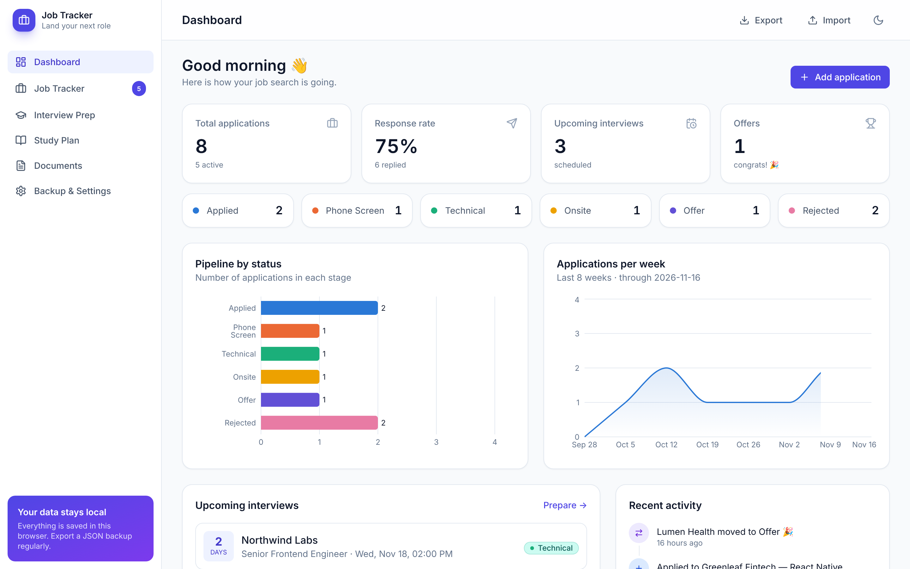
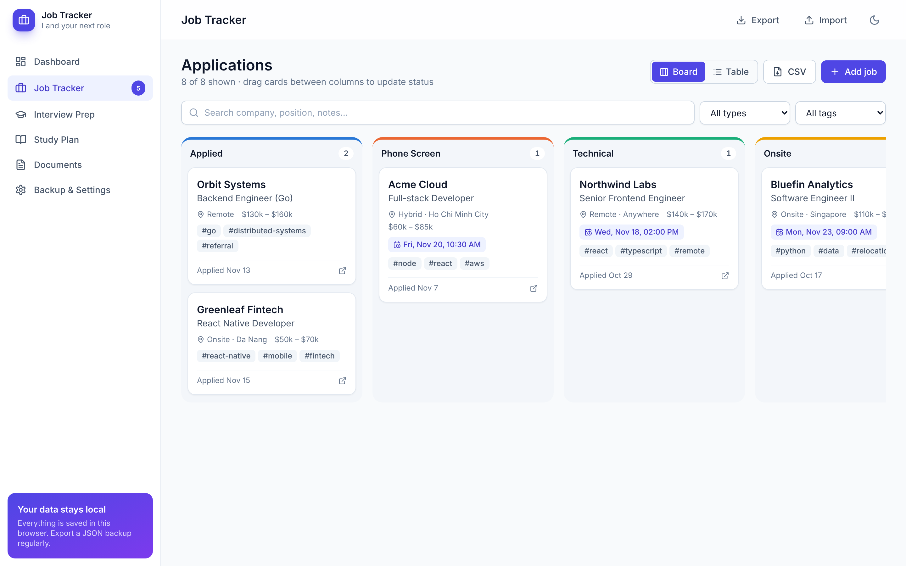
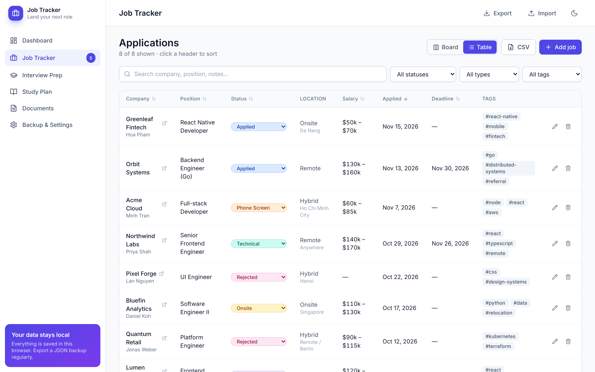
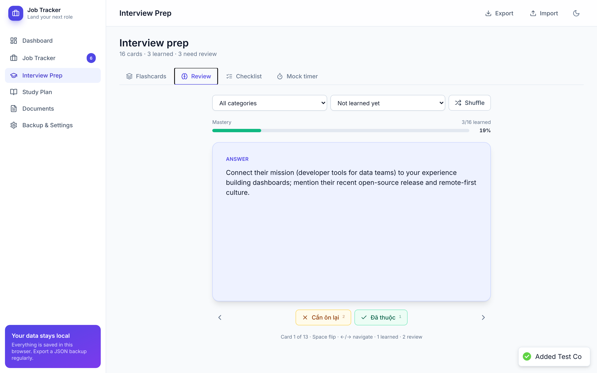
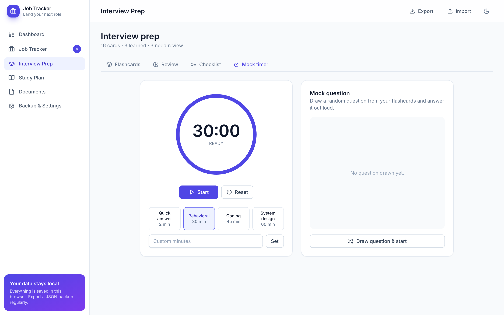
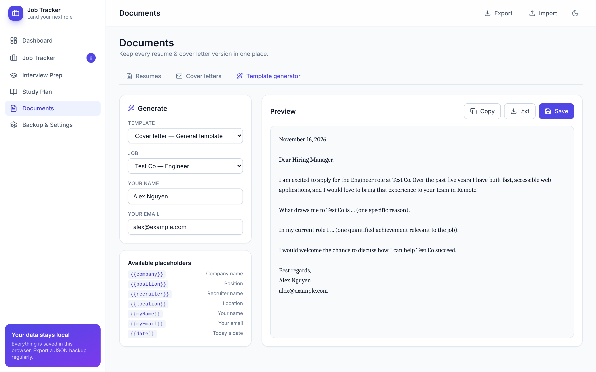

# 💼 Job Application Tracker

A complete, offline-first web app to manage your job search: track applications on a Kanban board, prepare for interviews with flashcards, plan your study week and keep every resume / cover-letter version in one place.

**No backend, no sign-up.** All data is stored in your browser's `localStorage`, with one-click JSON backup & restore.

> 🔗 **Live demo:** `https://<your-username>.github.io/job-tracker/` (after enabling GitHub Pages, see [Deploy](#-deploy-to-github-pages))



---

## ✨ Features

### 📊 Dashboard
- KPI tiles: total applications, response rate, upcoming interviews, offers
- Count of jobs per status (Applied → Phone Screen → Technical → Onsite → Offer → Rejected)
- Charts (Recharts): pipeline by status and applications per week (last 8 weeks)
- Upcoming interviews (with countdown) and deadlines in the next 2 weeks
- Recent activity timeline (every create / update / status change is logged)

### 🗂️ Job Tracker
- Add / edit / delete applications: company, position, work type (Remote / Onsite / Hybrid), city, job URL, salary range, status, date applied, deadline, next interview, notes, tags, recruiter name & email
- **Kanban board**: drag & drop cards between status columns (order is persisted)
- **Table view**: sortable columns, inline status change
- Search + filters (status, work type, tag)
- **Export to CSV** (Excel-friendly UTF-8)

### 🎯 Interview Prep
- Flashcards by category: **Behavioral (STAR template)**, **DSA**, **System Design**, **Language-specific**, **Company-specific**
- **Review mode**: shuffled deck, 3D flip, mark *Đã thuộc* (learned) / *Cần ôn lại* (needs review), mastery progress, keyboard shortcuts
- Pre-interview **checklist** with progress & quick-add suggestions
- **Mock interview timer** with presets, progress ring, end beep and random question draw

### 📚 Study Plan
- Weekly topics with tasks assigned to weekdays
- Daily checklist (today by default, switch to any weekday)
- Progress per topic and per week
- Save useful resources / links for each topic

### 📄 Documents
- Multiple text-based versions of resumes and cover letters, with autosave, copy, download `.txt`, "save as new version"
- **Cover-letter generator**: pick a template + a job and placeholders are filled automatically:
  `{{company}}` `{{position}}` `{{recruiter}}` `{{location}}` `{{myName}}` `{{myEmail}}` `{{date}}`

### 🎨 UI / UX
- Dark / light mode (remembers your choice, follows the system on first visit)
- Responsive layout with sidebar navigation (slide-in drawer on mobile)
- Colour-coded status badges (colour-blind-checked palette)
- Toast notifications for every action
- Smooth animations with Framer Motion

### 💾 Data & backup
- Everything is saved in `localStorage` (keys prefixed with `jt:`), synced live across tabs
- **Export / Import JSON** from the header or *Backup & Settings*
- Restore the demo data or clear everything from *Backup & Settings*
- Sample data is loaded on first launch so you can explore right away

---

## 🖼️ Screenshots

| Kanban board | Table view |
|---|---|
|  |  |

| Flashcard review | Mock interview timer |
|---|---|
|  |  |

| Study plan | Cover-letter generator |
|---|---|
|  |  |

| Dark mode | Mobile |
|---|---|
|  |  |

<!-- Replace these images with your own screenshots any time: docs/screenshots/*.png -->

---

## 🧱 Tech stack

| Concern | Library |
|---|---|
| Framework | React 18 + TypeScript + Vite 5 |
| Styling | Tailwind CSS 3 (class-based dark mode) |
| Routing | React Router 6 (`HashRouter` for GitHub Pages) |
| Charts | Recharts |
| Drag & drop | @hello-pangea/dnd |
| Animations | Framer Motion |
| Toasts | react-hot-toast |
| Icons | lucide-react |
| Storage | `localStorage` via a `useSyncExternalStore` hook |

---

## 🚀 Getting started

Requirements: **Node.js 18+** (20 recommended).

```bash
git clone https://github.com/<your-username>/job-tracker.git
```

```bash
cd job-tracker
```

```bash
npm install
```

```bash
npm run dev
```

Open http://localhost:5173.

| Script | Description |
|---|---|
| `npm run dev` | Start the dev server with HMR |
| `npm run build` | Type-check and build to `dist/` |
| `npm run preview` | Serve the production build locally (at `/job-tracker/`) |
| `npm run lint` | Type-check only |

---

## 🌐 Deploy to GitHub Pages

The repo ships with `.github/workflows/deploy.yml`, which builds and deploys on every push to `main`.

1. Push the code to a GitHub repository (e.g. `job-tracker`).
2. In the repo go to **Settings → Pages → Build and deployment → Source** and choose **GitHub Actions**.
3. Push to `main` (or run the workflow manually from the **Actions** tab).
4. Your site will be live at `https://<your-username>.github.io/<repo-name>/`.

**Base path:** `vite.config.ts` uses `/job-tracker/` by default; the workflow overrides it with `VITE_BASE=/<repo-name>/`, so renaming the repo just works. For a user site (`<username>.github.io`) build with `VITE_BASE=/`.

**Routing:** the app uses `HashRouter` (`/job-tracker/#/jobs`), so refreshing any page never 404s on a static host.

---

## 📖 How to use

1. **Add an application** – *Job Tracker → Add job* (or *Add application* on the dashboard). Only company and position are required.
2. **Move it through the pipeline** – drag the card to the next column on the board, or change the status inline in the table. Status changes appear in the dashboard timeline.
3. **Schedule interviews** – set *Next interview* in the job form; it shows up under *Upcoming interviews* with a countdown.
4. **Prepare** – in *Interview Prep*, add flashcards (behavioral cards come with a STAR template), then open *Review*:
   - `Space` flip · `←` / `→` previous / next · `1` learned · `2` needs review
5. **Run a mock interview** – *Mock timer*, pick a preset and press *Draw question & start*.
6. **Plan your week** – *Study Plan → Add topic*, add tasks per weekday and links; tick them off in the daily checklist.
7. **Tailor a cover letter** – write a template in *Documents → Cover letters* using placeholders, then use *Template generator*, choose the job and *Copy* / *Save*.
8. **Back up regularly** – *Export* in the header downloads a JSON file; *Import* restores it on any device or browser.

> ⚠️ Clearing your browser data removes everything stored by the app. Export a backup first.

---

## 🗂️ Project structure

```
job-tracker/
├── .github/workflows/deploy.yml   # CI: build + deploy to GitHub Pages
├── docs/screenshots/              # README images
├── public/favicon.svg
├── src/
│   ├── components/
│   │   ├── common/      # Modal, ConfirmDialog, StatusBadge, EmptyState
│   │   ├── layout/      # Sidebar, Header, ThemeToggle, navItems
│   │   ├── dashboard/   # StatsCards, Chart, UpcomingInterviews, Timeline
│   │   ├── jobs/        # JobForm, JobCard, KanbanBoard, JobTable, JobFilters
│   │   ├── prep/        # FlashCard, FlashcardManager, QuizMode, Checklist, Timer
│   │   ├── study/       # StudyPlan (topic card), ProgressBar, DailyChecklist
│   │   └── documents/   # ResumeEditor, CoverLetterTemplate
│   ├── hooks/           # useLocalStorage, useJobs, useFlashcards, useStudyPlan,
│   │                    # useDocuments, useTheme, useBackup
│   ├── types/           # Shared TypeScript types
│   ├── utils/           # storage, csv, date, status colours, template filling
│   ├── pages/           # Dashboard, Jobs, InterviewPrep, StudyPlan, Documents, Settings
│   ├── data/            # Sample jobs, flashcards, checklist templates, study plan, documents
│   ├── App.tsx          # Layout + routes
│   └── main.tsx         # Entry (HashRouter)
├── index.html
├── package.json
├── tailwind.config.ts
├── tsconfig*.json
└── vite.config.ts       # GitHub Pages base path
```

### Data model (localStorage)

| Key | Content |
|---|---|
| `jt:jobs` | `Job[]` |
| `jt:activities` | Activity log for the timeline (last 100) |
| `jt:flashcards` | `Flashcard[]` |
| `jt:checklist` | Pre-interview checklist |
| `jt:study` | `StudyTopic[]` (tasks + resources) |
| `jt:documents` | Resume / cover-letter versions |
| `jt:profile` | Your name & email for templates |
| `jt:theme` | `"light"` / `"dark"` |

---

## 📝 License

MIT — use it, fork it, land that job. 🍀
